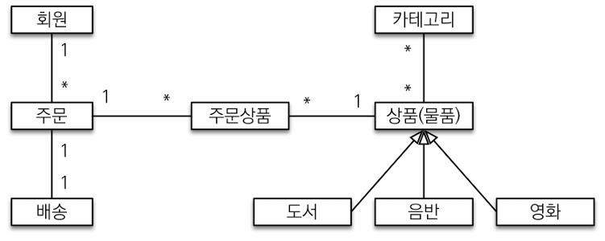

# 5주차(9~11)

# 도메인 모델과 테이블 설계



### 회원, 주문, 상품의 관계

회원 : 여러 상품을 주문할 수 있음. 한 번 주문할 때 여러 상품을 선택할 수 있으므로 주문과 상품은 다대다 관계

- but 다대다 관계는 관계형 데이터베이스는 물론이고 엔티티에서도 거의 사용하지 X

상품 분류 : 상품은 도서, 음반, 영화로 구분되는데 상품이라는 공통 속성을 사용하므로 상속 구조로 표현

### 회원 엔티티 분석


회원이 주문을 하기 때문에, 회원이 주문리스트를 가지는 것은 얼핏 보면 잘 설계한 것 같지만, 객체 세상은 실제 세계와는 다름

실무에서는 회원이 주문을 참조하지 않고, 주문이 회원을 참조하는 것으로 충분하다. 여기서는 일대다, 다대일의 양방향 연관관계를 설명하기 위해서 추가함

### 회원 테이블 분석


### 연관관계 매핑 분석

1. 회원과 주문 : 일대다 , 다대일의 양방향 관계 → 외래 키가 있는 주문을 연관관계의 주인으로 정하는 것이 좋음
2. 주문상품과 주문 : 다대일 양방향 관계 → 외래 키가 주문상품에 있으므로 주문상품이 연관관계의 주인
3. 주문상품과 상품: 다대일 단방향 관계
4. 주문과 배송: 일대일 양방향 관계
5. 카테고리와 상품:  `@ManyToMany`를 사용해서 매핑
    - 실무에서 @ManyToMany는 사용하지 X

참고: 외래 키가 있는 곳을 연관관계의 주인으로 정해야 함! → 연관관계의 주인은 단순히 외래 키를 누가 관리하냐의 문제이지 비즈니스상 우위에 있다고 주인으로 정하면 안됨
ex. 자동차와 바퀴가 있으면 : 일대다 관계에서 항상 다쪽에 외래 키가 있으므로 외래 키가 있는 바퀴를 연관관계의 주인으로 정함. 

- 만약 자동차를 연관관계의 주인으로 정하면 자동차가 관리하지 않는 바퀴 테이블의 외래 키 값이 업데이트 되므로 관리와 유지보수가 어렵고, 추가적으로 별도의 업데이트 쿼리가 발생하는 성능 문제가 존재함

# 엔티티 클래스 개발1

### 회원 엔티티

```java
package jpabook.jpashop.domain;

import jakarta.persistence.*;
import java.util.ArrayList;
import java.util.List;

@Entity
@Getter @Setter
public class Member {

    @Id @GeneratedValue
    @Column(name = "member_id")
    
		private Long id;
		private String name;
    
    @Embedded
		private Address address;
	   
	  @OneToMany(mappedBy = "member")
		private List<Order> orders = new ArrayList<>();
}
```

mappedBy = "member”를 활용해서 연관관계에서 비추는 거울이라고 나타냄

### 주문 엔티티

```java
package jpabook.jpashop.domain;

import lombok.Getter;
import lombok.Setter;

import jakarta.persistence.*;
import java.time.LocalDateTime;
import java.util.ArrayList;
import java.util.List;

@Entity
@Table(name = "orders")
@Getter @Setter
public class Order {

    @Id @GeneratedValue
    @Column(name = "order_id")
    private Long id;
    
    @ManyToOne(fetch = FetchType.LAZY)
    @JoinColumn(name = "member_id")
    private Member member; //주문 회원
    
    @OneToMany(mappedBy = "order", cascade = CascadeType.ALL)
		private List<OrderItem> orderItems = new ArrayList<>();
		
    @OneToOne(cascade = CascadeType.ALL, fetch = FetchType.LAZY)
    @JoinColumn(name = "delivery_id")
		private Delivery delivery; //배송정보
		
		private LocalDateTime orderDate; //주문시간
		
    @Enumerated(EnumType.STRING)
		private OrderStatus status; //주문상태 [ORDER, CANCEL]
		
		//==연관관계 메서드==//
		public void setMember(Member member) {
				this.member = member;
        member.getOrders().add(this);
    }
    
		public void addOrderItem(OrderItem orderItem) {
        orderItems.add(orderItem);
        orderItem.setOrder(this);
    }
    
		public void setDelivery(Delivery delivery) {
		this.delivery = delivery;
        delivery.setOrder(this);
    }
}
```