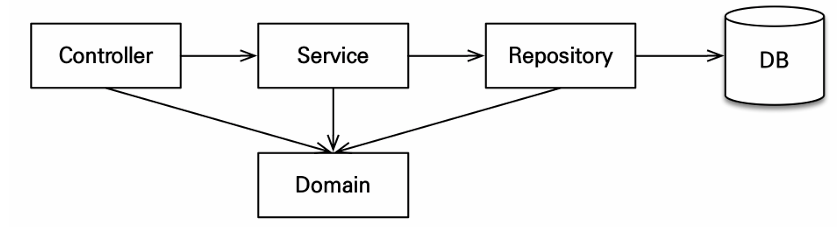

# 6주차(12~15)

# 엔티티 설계 시 주의점

### 엔티티 설계 시 주의점

1. 엔티티에는 가급적 Setter를 사용하지X
2. 모든 연관관계는 지연로딩으로 설정 : 즉시로딩은 예측이 어렵기 때문
3. 컬렉션은 필드에서 초기화
4. 테이블, 컬럼명 생성 전략 
    - https://docs.spring.io/spring-boot/docs/2.1.3.RELEASE/reference/htmlsingle/#howto-configure-hibernate-naming-strategy
    - [Hibernate ORM 5.4.33.Final User Guide](https://docs.hibernate.org/orm/5.4/userguide/html_single/#naming) → 하이버네이트 기존 구현 : 엔티티의 필드명을 그대로 테이블의 컬럼명으로 사용

# 구현 요구사항

### 구현 요구사항

1. 회원 기능 : 회원 등록, 회원 조회
2. 상품 기능 : 상품 등록, 상품 수정, 상품 조회
3. 주문 기능 : 상품 주문, 주문 내역 조회, 주문 취소

# 애플리케이션 아키텍처

### 애플리케이션 아키텍처

### 계층형 구조 사용

1. controller, web : 웹 계층
2. service : 비즈니스 로직, 트랜잭션 처리
3. repository : JPA를 직접 사용하는 계층, 엔티티 매니저 사용
4. domain : 엔티티가 모여 있는 계층, 모든 계층에서 사용

### 패키지 구조

jpabook.jpashop

- domain
- exception
- repository
- service
- web

### 개발 순서

서비스와 리포지토리 계층을 개발하고, 테스트 케이스를 작성해서 검증, 마지막에 웹 계층 적용